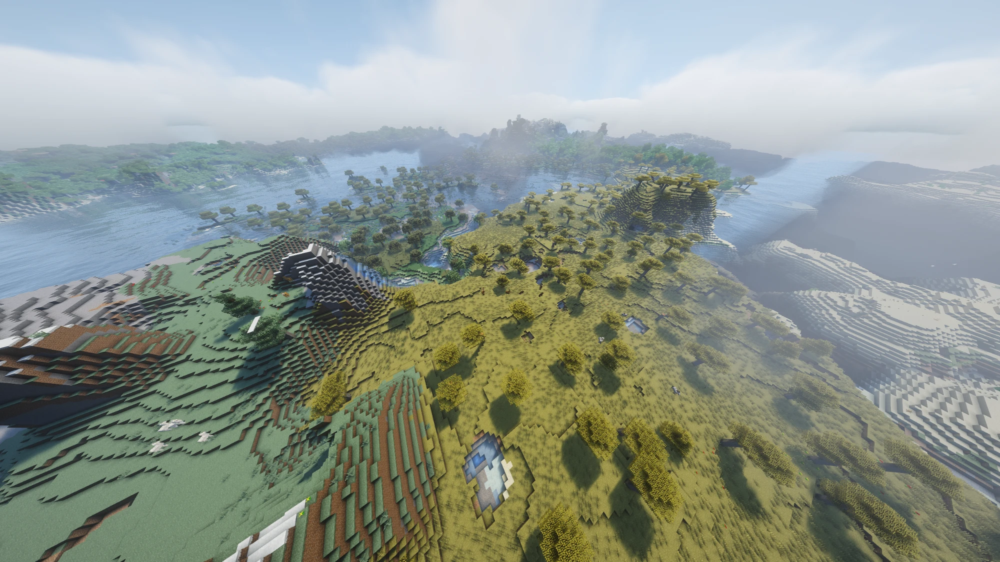
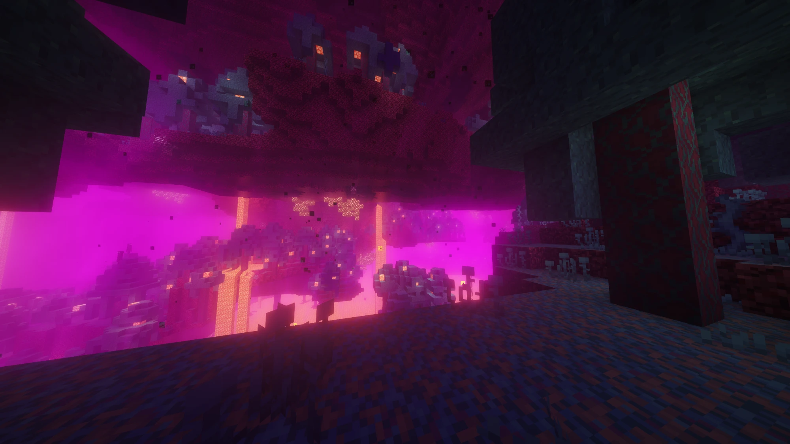

<!--
  The total downloads badge is filled in by .github/workflows/download-badge.yaml, which needs the repository
  variables MODRINTH_PROJECT (impetus_cleanroom) and CURSEFORGE_PROJECT_ID (1814628).
-->


# Impetus

[](https://www.curseforge.com/minecraft/mc-mods/impetus-cleanroom)
[](https://modrinth.com/mod/impetus_cleanroom)
[](https://github.com/BDmajora/Impetus/releases/latest)

[](https://github.com/BDmajora/Impetus/releases)
[](https://github.com/BDmajora/Impetus/releases)
[](https://www.curseforge.com/minecraft/mc-mods/impetus-cleanroom)
[](https://modrinth.com/mod/impetus_cleanroom)
[](https://github.com/BDmajora/Impetus/stargazers)

Impetus is a rendering engine and performance mod for Minecraft 1.12.2. It replaces the vanilla chunk renderer with
a multithreaded pipeline that draws terrain through multi-draw indirect, with an optional mesh-shader backend for
NVIDIA GPUs, and runs OptiFine and Iris shader packs, including the coloured lighting that OptiFine does not
support. Lighting is computed off the main thread, and further modules reduce memory use, load times and server
tick cost while staying compatible with large modpacks.

Impetus is a hard fork of [Celeritas](https://git.taumc.org/embeddedt/celeritas), built on the last free-licensed
versions of [Sodium](https://github.com/CaffeineMC/sodium) and [Iris](https://github.com/IrisShaders/Iris).

### Screenshots


<table>
  <tr>
    <td></td>
    <td></td>
  </tr>
  <tr>
    <td></td>
    <td></td>
  </tr>
  <tr>
    <td></td>
    <td></td>
  </tr>
</table>

---

### Downloads

Releases are published on [Modrinth](https://modrinth.com/mod/impetus_cleanroom),
[CurseForge](https://www.curseforge.com/minecraft/mc-mods/impetus-cleanroom) and
[GitHub Releases](https://github.com/BDmajora/Impetus/releases/latest).

You can also build the latest code yourself by following the [build instructions](#building-from-source).
Development builds are meant for testing and are not supported.

### Requirements

Impetus requires Minecraft 1.12.2 running on [Cleanroom](https://github.com/CleanroomMC/Cleanroom/releases) with
Java 25. Your graphics card and driver must support OpenGL 4.6. The optional Nvidium backend also requires an NVIDIA
GTX 16 series (Turing) card or newer.

### Installation

Put the jar in your `mods` folder. Cleanroom already provides Mixin and MixinExtras, so you do not need to install
them separately. Impetus turns off Cleanroom's Kirino renderer at startup so that the two do not both draw terrain.

Impetus works alongside VintageFix and FermiumMixins. It ships none of the memory features VintageFix provides
(on-demand models, texture stitching, block state maps, resource pack caches and the like) and none of the patches
FermiumMixins provides, so install VintageFix for those. Impetus tells VintageFix that it renders terrain, the same
way Celeritas does, so VintageFix leaves its vanilla chunk renderer patches off.

Remove Phosphor and Alfheim if you have them installed. Impetus has its own lighting engine, and running two
lighting engines at once corrupts world lighting. Impetus tries to disable them when it finds them, but you should
not rely on that.

The old Forge / Java 8 / LWJGL 2 version is on the `legacy` branch.

### Reporting issues

Report bugs, crashes and compatibility problems on the [issue tracker](https://github.com/BDmajora/Impetus/issues).
Please attach the crash report and the full launcher log.

## Why did I make Impetus?

1.12.2 is my favourite version of Minecraft. It has more mods than any other version, and it is the version I have
played the most with friends. The problem was that I had to choose between the Sodium forks, which are kept up to
date, and shaders through OptiFine, which has not been updated for 1.12.2 since 2019. Many modern performance mods
were also never ported to 1.12.2, and the ones that were often conflict with each other.

I wanted a single performance and shader mod that keeps up with Cleanroom and is easy to install. Impetus also
supports coloured lighting in shader packs, which OptiFine cannot run, so packs no longer have to fall back to
lower settings.

Impetus is fully open source, and anyone is free to fork it or contribute.

## How can I help?

* Star the project.
* Report bugs as an [issue](https://github.com/BDmajora/Impetus/issues) with logs attached.
* Pull requests are welcome. For large changes, please open an issue first so the approach can be discussed.

## Star History

<a href="https://www.star-history.com/#BDmajora/Impetus&Date">
  <picture>
    <source media="(prefers-color-scheme: dark)" srcset="https://api.star-history.com/svg?repos=BDmajora/Impetus&type=Date&theme=dark">
    <source media="(prefers-color-scheme: light)" srcset="https://api.star-history.com/svg?repos=BDmajora/Impetus&type=Date">
    
  </picture>
</a>

## Modules

Impetus ships as a single jar made up of several modules, each with its own mixin configuration.

| | Module | What it does |
| :-: | :----- | :----------- |
|  | `impetus` | The chunk renderer. It meshes chunks on worker threads and draws terrain with multi-draw indirect. It also includes an optional mesh-shader backend ported from Nvidium, which converts shader packs into `nvidium_shaderpacks/`. |
|  | `umbra` | The shader pipeline, based on Iris and Oculus. It loads OptiFine and Iris shader packs. |
|  | `fulgor` | The lighting engine, which replaces Phosphor and Alfheim. It runs either a Phosphor-style engine with parallel light passes or an asynchronous engine ported from Pulsar. |
|  | `coarctatio` | Reduces memory use and load times with on-demand model loading, parallel texture decoding, resource lookup caches, a persistent mod scan cache, lazy item capabilities and block state and model deduplication. |
|  | `equilibrium` | Speeds up world and server ticks with chunk access caching, world generation fast paths, advancement, crafting and furnace caches, ghost-chunk guards and an optional tick budget. |
| | `dynamiclights` | Adds dynamic light from held and dropped items. |
| | `extras` | Contains optional features: render budget, GPU Booster, parallel entity ticking, parallel particles, baked block entities, ray-cast entity culling, HUD caching, text batching, network optimizations and a zoom key. |
| | `linuxextras` | Fixes Linux issues. It opens the window on the primary monitor and uses `xdg-open` for links and folders. |

## Building from source

You need JDK 25. Run:

```
./run.sh build
```

Running `./run.sh` without arguments opens a menu instead. The jar is written to `build/libs/<version>/`.

Impetus uses LWJGL 3 throughout. Vanilla's LWJGL 2 calls are handled by Cleanroom's lwjgly bridge, and Impetus only
uses LWJGL 2 names where a vanilla method signature requires them.

## Credits

### Art

* **ProprietaryCable** ([proprietarycables@gmail.com](mailto:proprietarycables@gmail.com)) drew the Impetus and
  module icons.

### Upstream projects

* **JellySquid and the CaffeineMC team** made [Sodium](https://github.com/CaffeineMC/sodium) and released 0.5.11
  and earlier as free software.
* **coderbot, IMS and the Iris contributors** made [Iris](https://github.com/IrisShaders/Iris), which the shader
  pipeline comes from.
* **embeddedt** made [Celeritas](https://git.taumc.org/embeddedt/celeritas), which Impetus is forked from, and
  [Embeddium](https://github.com/embeddedt/embeddium) before it.
* **Asek3** made [Rubidium](https://github.com/Asek3/Rubidium) and [Oculus](https://github.com/Asek3/Oculus), the
  Forge ports of Sodium and Iris.
* **Mumfrey** made [Mixin](https://github.com/SpongePowered/Mixin), and **CleanroomMC** made
  [Cleanroom](https://github.com/CleanroomMC/Cleanroom) and CleanMix.
* **Rongmario** made [MixinBooter](https://github.com/CleanroomMC/MixinBooter).
* **LlamaLad7** made [MixinExtras](https://github.com/LlamaLad7/MixinExtras).

### Code and ideas

Impetus uses code or ideas from the following projects.

* **MCRcortex**, [Nvidium](https://github.com/MCRcortex/nvidium) (LGPL-3). The mesh-shader terrain backend is ported
  from it.
* **Sumire Labs**, [Pulsar](https://github.com/Sumire-Labs/Pulsar) (LGPL-3), which grew out of
  [SuperNova](https://github.com/GTNewHorizons/SuperNova) (LGPL-3) by GTNewHorizons. Fulgor's async mode is ported
  from it.
* **orf**, [GpuShift](https://modrinth.com/mod/gpushift) (All Rights Reserved). The render budget is a clean-room
  implementation of its idea. No code was taken from it.
* **tr7zw**, [Entity Culling](https://github.com/tr7zw/EntityCulling) (tr7zw Protective License), and **Meldexun**,
  the 1.12.2 [Entity Culling](https://github.com/Meldexun/EntityCulling) (All Rights Reserved). Ray-cast entity
  culling is a clean-room implementation of their idea. No code was taken from either.
* **Moulberry**, [HUDCaching](https://github.com/Moulberry/MCHUDCaching) (CC BY-NC 3.0). The HUD cache is a
  clean-room implementation of its idea. No code was taken from it.
* **Mr.Toad**, [GPUBooster](https://github.com/ITsMrToad/GPUBooster) (GPL-3)
* **AxalotL**, [Async](https://github.com/AxalotLDev/Async) (GPL-3), and the authors of MCMT and
  [JMT-MCMT](https://github.com/jediminer543/JMT-MCMT) (BSD-2-Clause)
* **Harvey_Husky**, [AsyncParticles](https://github.com/Harveykang/AsyncParticles) (LGPL-3)
* **fzzyhmstrs**, [Particle Core](https://github.com/fzzyhmstrs/pc) (MIT)
* **FoundationGames**, [Enhanced Block Entities](https://github.com/FoundationGames/EnhancedBlockEntities) (LGPL-3)
* **Ceeden**, [Better Block Entities](https://github.com/EdeenMC/betterblockentities) (LGPL-3)
* **malte0811**, [FerriteCore](https://github.com/malte0811/FerriteCore) (MIT)
* **Steveplays28**, [Noisium](https://github.com/Steveplays28/noisium) (LGPL-3)
* **TonimatasDEV**, [Packet Fixer](https://github.com/TonimatasDEV/PacketFixer) (MIT)
* **Spottedleaf**, [Starlight](https://github.com/PaperMC/Starlight) (LGPL-3)
* **ishland**, [ScalableLux](https://github.com/RelativityMC/ScalableLux) (LGPL-3)
* **wisecase2**, [StutterFix](https://github.com/wisecase2/StutterFix) (MIT)
* **asie**, [FoamFix](https://github.com/asiekierka/FoamFix) (LGPL-3)
* **Rongmario**, Chibi and [LoliASM](https://web.archive.org/web/20260714065606/https://github.com/LoliKingdom/LoliASM)
  (LGPL-2.1)
* **Kasumi_Nova** and **Circulate233**, [StellarCore](https://github.com/NovaEngineering-Source/StellarCore) (LGPL-3)
* **embeddedt** and the [VintageFix](https://github.com/embeddedt/VintageFix) contributors (LGPL-3), for
  Coarctatio's on-demand model loading and texture discovery.
* **Runemoro**, for the original dynamic resources work in [VanillaFix](https://github.com/DimensionalDevelopment/VanillaFix) (MIT).
* **ACGaming** and the [Universal Tweaks](https://github.com/ACGaming/UniversalTweaks) contributors (LGPL-3)
* **Mephodio**, [Icterine](https://github.com/Mephodio/Icterine) (GPL-3)
* **VidTu**, [Ksyxis](https://github.com/VidTu/Ksyxis) (MIT)
* **tr7zw**, [Exordium](https://github.com/tr7zw/Exordium) (LGPL-3)
* **Luna Lage (Desoroxxx)** and Red Studio, [Valkyrie](https://github.com/Red-Studio-Ragnarok/Valkyrie) (MIT)
* **Andrew Steinborn (astei)**, [Krypton](https://github.com/astei/krypton) (LGPL-3)
* **RaphiMC**, [ImmediatelyFast](https://github.com/RaphiMC/ImmediatelyFast) (LGPL-3)
* **imthosea**, [BadOptimizations](https://github.com/imthosea/BadOptimizations) (ISC)
* **fxmorin**, [More Culling](https://github.com/fxmorin/MoreCulling) (GPL-3)
* **isXander**, [Cull Less Leaves](https://github.com/isXander/CullLessLeaves) (LGPL-3)
* **jaredlll08**, [Clumps](https://github.com/jaredlll08/Clumps) (MIT)
* **decce6**, [Gnetum](https://github.com/decce6/Gnetum) (LGPL-3)
* **LogicalGeekBoy** and the Logical Zoom contributors, [Logical Zoom](https://github.com/LogicalGeekBoy/logical_zoom)
  (MIT)

## License

Impetus is licensed under the [GNU Lesser General Public License version 3](LICENSE). It only uses code from Iris
1.7, Sodium 0.5.11 and earlier, Celeritas, and other free and open-source projects.

Impetus contains no code from Sodium 0.5.12 or 0.6 and later, because those versions are not available under a free
and open-source license. Features inspired by modern Sodium are independent implementations written from scratch.
