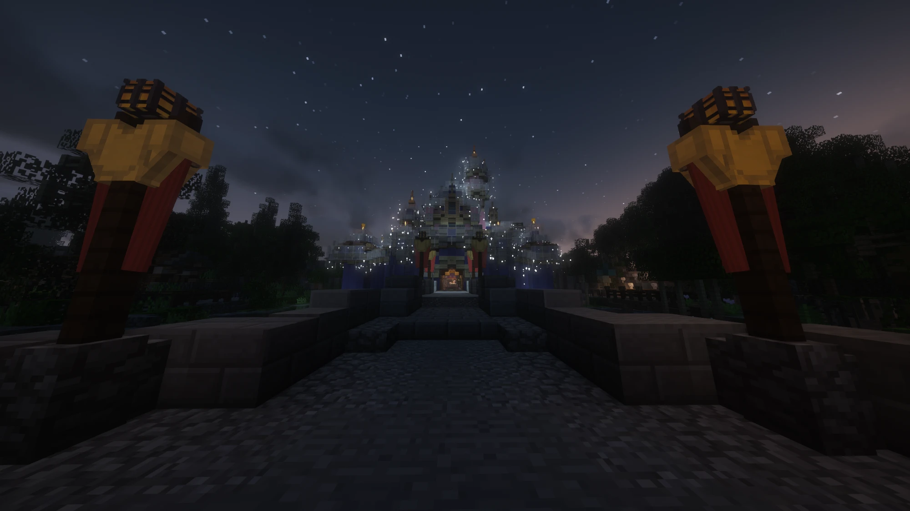
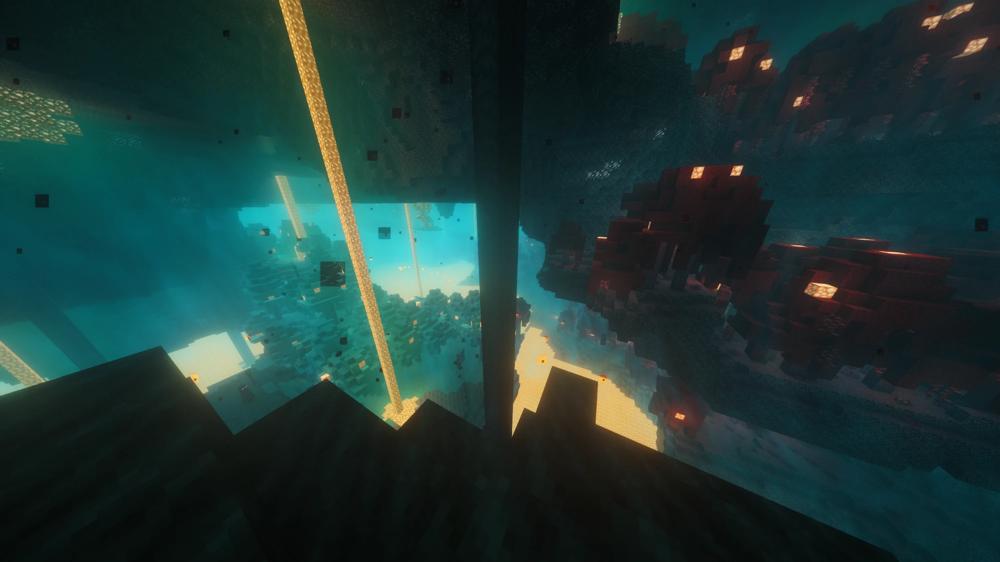
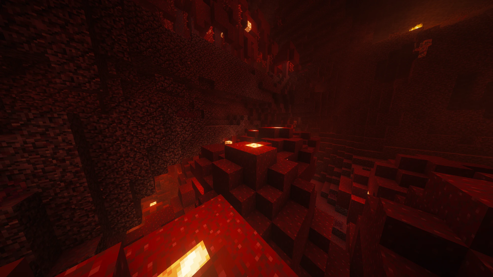
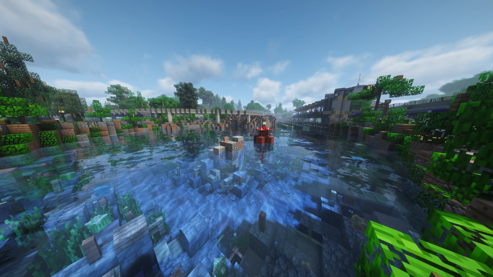

<!--
  Placeholders to fill in once the project pages exist:
    CURSEFORGE_PROJECT_ID  numeric id from the "About Project" sidebar on the CurseForge page
    MODRINTH_SLUG          the project slug (or id) from the Modrinth page URL
  The page links below also assume the slug "impetus" on both sites.
  The total downloads badge is filled in by .github/workflows/download-badge.yaml, which needs the same two values
  as the repository variables MODRINTH_PROJECT and CURSEFORGE_PROJECT_ID.
-->


# Impetus

[](https://www.curseforge.com/minecraft/mc-mods/impetus)
[](https://modrinth.com/mod/impetus)
[](https://github.com/BDmajora/Impetus/releases/latest)

[](https://github.com/BDmajora/Impetus/releases)
[](https://github.com/BDmajora/Impetus/releases)
[](https://www.curseforge.com/minecraft/mc-mods/impetus)
[](https://modrinth.com/mod/impetus)
[](https://github.com/BDmajora/Impetus/stargazers)

Impetus is a rendering engine and performance mod for Minecraft 1.12.2. It replaces the vanilla chunk renderer with
a multithreaded pipeline that draws terrain through multi-draw indirect, with an optional mesh-shader backend for
NVIDIA GPUs, and runs OptiFine and Iris shader packs, including the coloured lighting that OptiFine does not
support. Lighting is computed off the main thread, and further modules reduce memory use, load times and server
tick cost while staying compatible with large modpacks.

Impetus is a hard fork of [Celeritas](https://git.taumc.org/embeddedt/celeritas), built on the last free-licensed
versions of [Sodium](https://github.com/CaffeineMC/sodium) and [Iris](https://github.com/IrisShaders/Iris).

### Screenshots


<table>
  <tr>
    <td></td>
    <td></td>
  </tr>
  <tr>
    <td></td>
    <td></td>
  </tr>
  <tr>
    <td></td>
    <td></td>
  </tr>
</table>

---

### Downloads

#### Stable builds

Official releases of Impetus are published only on our [Modrinth](https://modrinth.com/mod/impetus) and
[CurseForge](https://www.curseforge.com/minecraft/mc-mods/impetus) pages and on
[GitHub Releases](https://github.com/BDmajora/Impetus/releases/latest).

#### Development builds

You can build the latest code yourself by following the [build instructions](#building-from-sources). Development builds are meant
for testing. They haven't been checked as carefully as a release and come with no support or warranty.

### Installation

Impetus needs **Minecraft 1.12.2** running on **[Cleanroom](https://github.com/CleanroomMC/Cleanroom/releases)** with
**Java 25**. Put the jar in your `mods` folder.

You don't need to install Mixin or MixinExtras, since Cleanroom provides both. Cleanroom also turns on its own
Kirino render engine by default. Impetus switches Kirino off at startup so the two don't both draw terrain.

Remove Phosphor and Alfheim if you have them installed, since Impetus includes its own lighting engine. Impetus
disables them when it detects them, because two lighting engines running at once will corrupt a world's lighting,
but removing them is the reliable option.

Looking for the old Forge / Java 8 / LWJGL 2 version? It lives on the `legacy` branch.

### Reporting Issues

Bugs, crashes and compatibility problems go on the [issue tracker](https://github.com/BDmajora/Impetus/issues).
Please attach the crash report and the full launcher log. A description on its own usually isn't enough to find
the problem.

## Why did you make Impetus?

1.12.2 is my favourite version of Minecraft. It has more mods than any other version, and it's the one I've spent the
most time playing with friends. My main problem with it was having to choose between the Sodium forks,
which are kept up to date, and shaders through OptiFine. They're two separate ecosystems, each with its own
advantages and disadvantages. On top of that, a lot of modern performance mods were never ported to 1.12.2, and the
ones that were often conflict with each other.

I wanted a single performance and shader mod that stays up to date with Cleanroom and is easy to use. OptiFine for
1.12.2 hasn't been updated since 2019. Impetus also supports coloured lighting in shader packs, so packs don't have
to drop to the lower settings they're stuck on under OptiFine.

Impetus is fully open source, and anyone is free to fork it or contribute.

## How can I help?

* Report bugs, with logs. Crash reports from big modpacks are especially useful.
* Pull requests are welcome. If you're planning something large, open an issue first so we can talk it through
  before you put the time in.

## Star History

<a href="https://www.star-history.com/#BDmajora/Impetus&Date">
  <picture>
    <source media="(prefers-color-scheme: dark)" srcset="https://api.star-history.com/svg?repos=BDmajora/Impetus&type=Date&theme=dark">
    <source media="(prefers-color-scheme: light)" srcset="https://api.star-history.com/svg?repos=BDmajora/Impetus&type=Date">
    
  </picture>
</a>

Thank you to everyone who has starred the project so far.

## What's included

Impetus ships as a single jar made up of several modules, each with its own mixin configuration.

| | Module | What it does |
| :-: | :----- | :----------- |
|  | `impetus` | Chunk renderer. Meshes chunks on worker threads and draws terrain with multi-draw indirect. Includes an optional mesh-shader backend ported from Nvidium, which converts shader packs into `nvidium_shaderpacks/`. |
|  | `umbra` | Shader pipeline based on Iris and Oculus. Loads OptiFine and Iris format shader packs. |
|  | `fulgor` | Lighting engine that replaces Phosphor and Alfheim. Runs either a Phosphor-style engine with parallel light passes or an asynchronous engine ported from Pulsar. |
|  | `coarctatio` | Memory and load time: block state and model deduplication, lazy item capabilities, resource lookup caches, a persistent mod scan cache, parallel texture decoding and optional on-demand model loading. |
|  | `equilibrium` | World and server ticks: chunk access caching, world generation fast paths, advancement, crafting and furnace caches, ghost-chunk guards and an optional tick budget. |
| | `dynamiclights` | Dynamic light from held and dropped items. |
| | `extras` | Toggleable features: render budget, GPU Booster, parallel entity ticking, parallel particles, baked block entities, ray-cast entity culling, HUD caching, text batching, network optimizations and a zoom key. |
| | `linuxextras` | Linux fixes: opens the window on the primary monitor and uses `xdg-open` for links and folders. |

## Hardware Compatibility

Your graphics card and driver need to support OpenGL 4.6, the newest version Cleanroom requests.

The optional Nvidium backend has the same requirement as the original [Nvidium](https://github.com/MCRcortex/nvidium):
an NVIDIA GTX 16 series (Turing) card or newer.

## Building from sources

You need JDK 25. Then run:

```
./run.sh
```

Pick Build from the menu, or run `./run.sh build` directly. The jar is written to `build/libs/<version>/`.

Impetus uses LWJGL 3 throughout. Vanilla's LWJGL 2 calls are handled by Cleanroom's lwjgly bridge, and Impetus only
uses LWJGL 2 names where a vanilla method signature requires them.

## Credits

This is where the code and ideas in Impetus came from. If a feature reminds you of another mod, you'll probably
find it here.

### Upstream projects

* **JellySquid and the CaffeineMC team**, for [Sodium](https://github.com/CaffeineMC/sodium), and for releasing 0.5.11
  and earlier as free software
* **coderbot, IMS and the Iris contributors**, for [Iris](https://github.com/IrisShaders/Iris), where the shader
  pipeline comes from
* **embeddedt**, for [Celeritas](https://git.taumc.org/embeddedt/celeritas), which Impetus is forked from, and
  [Embeddium](https://github.com/embeddedt/embeddium) before it
* **Asek3**, for [Rubidium](https://github.com/Asek3/Rubidium), the original Forge port of Sodium, and
  [Oculus](https://github.com/Asek3/Oculus), the Forge port of Iris
* **Mumfrey**, for [Mixin](https://github.com/SpongePowered/Mixin), and **CleanroomMC** for
  [Cleanroom](https://github.com/CleanroomMC/Cleanroom) and CleanMix
* **Rongmario**, for [MixinBooter](https://github.com/CleanroomMC/MixinBooter)
* **LlamaLad7**, for [MixinExtras](https://github.com/LlamaLad7/MixinExtras)

### Art

* **ProprietaryCable** ([proprietarycables@gmail.com](mailto:proprietarycables@gmail.com)), for drawing the Impetus
  and module icons, plus a lot of designs that didn't end up getting used
* **CelestialAbyss**, for the Embeddium logo, and **input-Here** for touching it up

### Code and ideas

* **MCRcortex**, for [Nvidium](https://github.com/MCRcortex/nvidium) (LGPL-3). The mesh-shader terrain backend is
  ported from it.
* **orf**, for the ideas behind [GpuShift](https://modrinth.com/mod/gpushift) (All Rights Reserved). The Render Budget
  group is a clean-room 1.12.2 implementation of its adaptive render budget, CPU/GPU bottleneck detector included: the
  idea comes from GpuShift, the code is my own.
* **Mr.Toad**, for [GPUBooster](https://github.com/ITsMrToad/GPUBooster) (GPL-3), ported to 1.12.2 as the GPU Booster
  group
* **AxalotL**, for [Async](https://github.com/AxalotLDev/Async) (GPL-3), and the authors of MCMT and
  [JMT-MCMT](https://github.com/jediminer543/JMT-MCMT) (BSD-2-Clause) it builds on. The Parallel Ticking group reimplements its
  parallel entity ticking for 1.12.2.
* **Harvey_Husky**, for [AsyncParticles](https://github.com/Harveykang/AsyncParticles) (LGPL-3). Parallel particle
  ticking, the particle light cache and off-screen particle culling are based on it.
* **fzzyhmstrs**, for [Particle Core](https://github.com/fzzyhmstrs/pc) (MIT), the source of the particle collision
  cache
* **FoundationGames**, for [Enhanced Block Entities](https://github.com/FoundationGames/EnhancedBlockEntities)
  (LGPL-3), and **Ceeden**, for [Better Block Entities](https://github.com/EdeenMC/betterblockentities) (LGPL-3).
  The Baked Block Entities group rebuilds their approach from the vanilla entity models.
* **malte0811**, for [FerriteCore](https://github.com/malte0811/FerriteCore) (MIT). Coarctatio uses its block state
  and model deduplication techniques.
* **Steveplays28**, for [Noisium](https://github.com/Steveplays28/noisium) (LGPL-3), the basis for Equilibrium's
  world generation fast paths
* **TonimatasDEV**, for [Packet Fixer](https://github.com/TonimatasDEV/PacketFixer) (MIT), the basis for the Network
  group
* **Spottedleaf**, for [Starlight](https://github.com/PaperMC/Starlight) (LGPL-3), and **ishland**, for
  [ScalableLux](https://github.com/RelativityMC/ScalableLux) (LGPL-3). Fulgor schedules its light passes the way they
  do.
* **Sumire Labs**, for [Pulsar](https://github.com/Sumire-Labs/Pulsar) (LGPL-3). Fulgor's async mode is ported from
  it. Pulsar itself grew out of [SuperNova](https://github.com/GTNewHorizons/SuperNova) (LGPL-3) by GTNewHorizons.
* **wisecase2**, for [StutterFix](https://github.com/wisecase2/StutterFix) (MIT), the basis for the Thread Scheduling
  group
* **asie**, for [FoamFix](https://github.com/asiekierka/FoamFix) (LGPL-3). Equilibrium carries its ghost-chunk guards,
  spawner check cache and idle entity cleanup.
* **Rongmario**, again, for Chibi and [LoliASM](https://web.archive.org/web/20260714065606/https://github.com/LoliKingdom/LoliASM) (LGPL-2.1). The lazy item
  capabilities, furnace recipe index, entity factory, loader string interning, remapper cache compaction, recycled
  events and the world load and screenshot tweaks are based on them.
* **Kasumi_Nova** and **Circulate233**, for [StellarCore](https://github.com/NovaEngineering-Source/StellarCore)
  (LGPL-3). The numeric tag pool, hash caches, long-keyed tile entity map, HUD caching approach, parallel texture
  decoding, primitive ore dictionary and model part pooling all started there.
* **embeddedt**, again, for [VintageFix](https://github.com/embeddedt/VintageFix) (LGPL-3). The mod scan cache,
  resource existence caches, stackless resource exceptions, shelf stitching, soft structure templates, fast item
  baking and dynamic model loading are based on it. Dynamic model loading goes back further, to **Runemoro**'s
  dynamic resources in [VanillaFix](https://github.com/DimensionalDevelopment/VanillaFix) (MIT).
* **ACGaming** and the [Universal Tweaks](https://github.com/ACGaming/UniversalTweaks) contributors (jchung01,
  Darkhax, EverNife, Barteks2x) (LGPL-3), for the advancement trigger, crafting cache, pathfinding chunk guard, entity
  radius check, chunk generation limit, sound debug skip, quiet prefix check and plain missing models
* **Mephodio**, for [Icterine](https://github.com/Mephodio/Icterine) (GPL-3), where the advancement trigger
  optimisation first appeared
* **VidTu**, for [Ksyxis](https://github.com/VidTu/Ksyxis) (MIT), which showed how to skip the spawn chunk preload
* **tr7zw**, for [Entity Culling](https://github.com/tr7zw/EntityCulling) (tr7zw Protective License)
  and [Exordium](https://github.com/tr7zw/Exordium) (LGPL-3), and **Meldexun**, for the 1.12.2
  [Entity Culling](https://github.com/Meldexun/EntityCulling) (All Rights Reserved). Ray-cast occlusion culling of
  entities and block entities is a clean-room implementation: the idea comes from their work, the code is my own.
* **Luna Lage (Desoroxxx)** and Red Studio, for [Valkyrie](https://github.com/Red-Studio-Ragnarok/Valkyrie)
  (MIT), the basis for the ModelRenderer matrix path
* **Andrew Steinborn (astei)**, for [Krypton](https://github.com/astei/krypton) (LGPL-3). Flush consolidation and the
  varint, frame decoder and compression paths come from it.
* **RaphiMC**, for [ImmediatelyFast](https://github.com/RaphiMC/ImmediatelyFast) (LGPL-3), the basis for text glyph
  batching
* **imthosea**, for [BadOptimizations](https://github.com/imthosea/BadOptimizations) (ISC), the basis for
  lightmap and entity flag caching
* **fxmorin**, for [More Culling](https://github.com/fxmorin/MoreCulling) (GPL-3), the basis for item frame LOD and
  leaf face culling, and **isXander** for [Cull Less Leaves](https://github.com/isXander/CullLessLeaves) (LGPL-3)
* **jaredlll08**, for [Clumps](https://github.com/jaredlll08/Clumps) (MIT), the basis for experience orb merging
* **decce6**, for [Gnetum](https://github.com/decce6/Gnetum) (LGPL-3), and **Moulberry**, for
  [HUDCaching](https://github.com/Moulberry/MCHUDCaching) (CC BY-NC 3.0). The HUD cache is a clean-room
  implementation of the same idea, with no code taken from either.
* **LogicalGeekBoy** and the Logical Zoom contributors, for [Logical Zoom](https://github.com/LogicalGeekBoy/logical_zoom)
  (MIT), ported with its defaults as the Zoom group

## License

Impetus is licensed under the [GNU Lesser General Public License version 3](LICENSE). It only uses code from Iris
1.7, Sodium 0.5.11 and earlier, Celeritas, and other free and open-source projects.

Impetus does not contain, and will not contain, any code from Sodium 0.5.12 or 0.6 and later, because those
versions are not available under a free and open-source license. Features inspired by modern Sodium are
independent implementations written from scratch.
